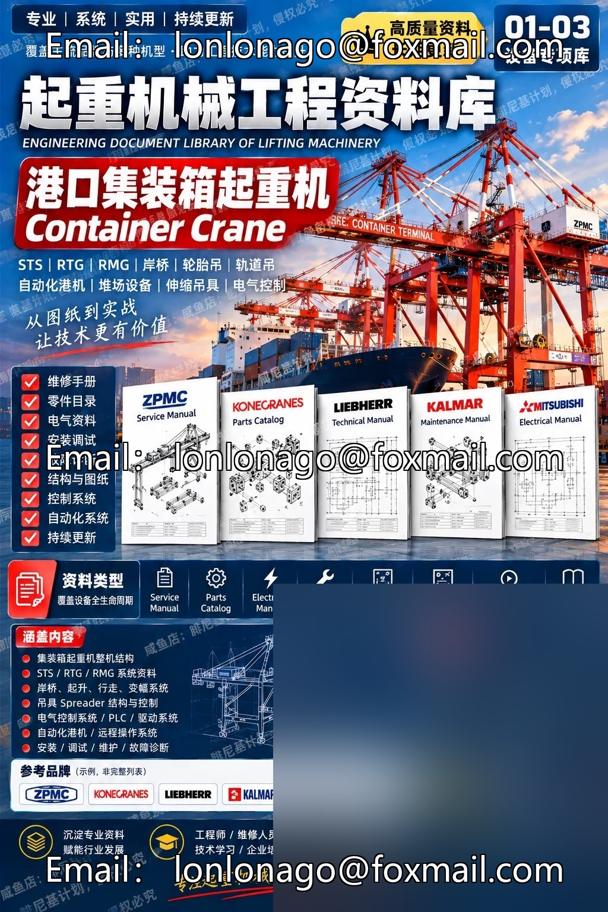

# Crane mechanical engineering data library (port crane)

## Body

Cranrier Mechanical Engineering Material Database (port crane)
[1] [F] Need what equipment? DM later, non-listed price!
ZPMC/KONECRANES/LIEBHERR/KALMAR/MITSUBISHI
Complete technical documents on crane maintenance manuals, part directories, electrical materials, installation and debugging, fault diagnosis, structure and drawings, control systems, automation systems, covering mainstream brands and multiple models, including STS, RTG, RMG, crane, tire crane, track crane, applicable to port terminals, yard areas, logistics transport, ship loading and unloading, automated ports, etc., applicable to port terminals, yard areas, logistics transport, ship loading and unloading, automated ports, etc.

The materials are complete, including Service Manual, Parts Catalog, Electrical Manual, Hydraulic Manual, PLC/Control Manual, Drawing & Diagram, Troubleshooting Guide, Operation Manual, etc. The content is detailed, the structure is clear, and it is suitable for engineers, maintenance personnel, and technical personnel for learning, training, and practical application.

Please for what equipment is needed, and prices are not for sale!

refunds upon sale.

The library covers lifting machinery engineering content including maintenance manuals, parts catalogs, electrical materials, installation and tuning, fault diagnosis, structural and drawing, control systems and automation systems; it covers mainstream brands and multiple model types and is suitable for ports, yard, logistics, ship loading/unloading and automated port scenarios.

<!-- AI_ENRICHED -->

## Images

## Payment

Here is a pay link on Stripe ( https://buy.stripe.com/3cs8yP7sY87d0vu9AB ). Please contact me lonlonago@foxmail.com after funding $89, and I will send you a complete data files , thank you!

